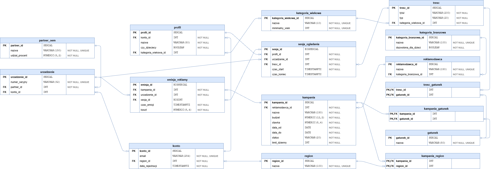
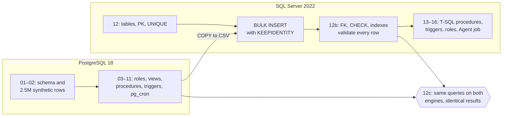

# streamos-database

[](https://github.com/cienkowd/streamos-database/actions/workflows/database.yml)

> Relational database for a fictional ad-supported smart TV streaming platform. Designed in
> PostgreSQL 18, then migrated to SQL Server 2022, with per-company access through
> row-filtered views, triggers that enforce advertising rules, scheduled jobs (pg_cron and
> SQL Server Agent), and a one-command Docker pipeline that rebuilds and tests both databases.



## What it models

- **Viewers:** accounts in regions, several profiles per account, kids profiles with an age limit.
- **OEM partners:** TV manufacturers with a revenue share, and devices that may not be activated yet.
- **Content:** films, episodes and shows with genres and age ratings.
- **Advertising:** advertisers in industry categories (some not allowed for children), campaigns with a budget, a rate per impression, a date range, a daily limit per device and region/genre targeting.
- **Events:** viewing sessions and ad impressions.

The data is fully synthetic and generated in SQL: 5,000 accounts, 12,500 profiles,
8,000 devices, 2,000 titles, 60 campaigns, 1,000,000 viewing sessions and about
1.5–1.6 million ad impressions (the generator is randomized, so counts vary slightly per run).

## Features

**PostgreSQL 18** (`sql/postgres`)

| Script | What it does |
|---|---|
| `01`, `02` | Schema with PK/FK/UNIQUE/CHECK constraints; synthetic data generator |
| `03`, `05` | Group roles for advertisers and partners with no direct table access; views filtered by `current_user`, so each company sees only its own campaigns, impressions or revenue |
| `04` | Business queries: monthly partner settlement, most watched content on kids profiles, daily impression-limit audit |
| `06` | Index tuning measured with `EXPLAIN (ANALYZE, BUFFERS)` |
| `07`, `08` | Remaining-budget function; procedures to create an account, activate a device and create a campaign with its targeting in one transaction, with readable error messages |
| `09` | Trigger validating every ad impression: campaign status and dates, remaining budget, daily per-device limit, industries not allowed on kids profiles or kids content, session/device consistency. The cost comes from the campaign rate |
| `10` | Remaining consistency rules (CHECKs, session trigger) and a partner settlement function |
| `11` | Daily `pg_cron` job: closes expired and exhausted campaigns, computes the daily partner settlement (catching up missed days) and logs every step |

**SQL Server 2022** (`sql/mssql`)

| Script | What it does |
|---|---|
| `12`, `12b`, `12c` | Schema port with T-SQL type mapping; constraints added after the data load so every migrated row is validated; row counts, key sums and money totals compared with PostgreSQL |
| `13`–`16` | Functions and procedures, triggers, logins/users/roles with the same row-filtered views (`EXECUTE AS` tests), and a SQL Server Agent job |

## Migration: PostgreSQL → SQL Server

The database was built in PostgreSQL first, then moved to SQL Server: schema, all
2.5 million rows, and every procedure, trigger, role and scheduled job.



The migration is checked three ways:
- constraints are added only after the load, so SQL Server validates every migrated row;
- `12c` compares row counts, key sums (they catch renumbered IDs) and money totals between the engines;
- test scripts `13b`–`16b` rerun the procedure, trigger, permission and scheduled-job scenarios on SQL Server.

The main differences that required redesign rather than translation:

| Topic | PostgreSQL | SQL Server |
|---|---|---|
| Types and keys | `SERIAL`, `BOOLEAN`, `TIMESTAMPTZ`, `TEXT` | `IDENTITY`, `BIT`, `DATETIMEOFFSET`, `VARCHAR(MAX)` |
| Unique column with many NULLs | `UNIQUE` allows any number of NULLs | `UNIQUE` allows one NULL, so it becomes a filtered unique index (`WHERE … IS NOT NULL`) |
| List parameters | `INT[]` arrays | user-defined table type passed as a table-valued parameter |
| Atomic procedures | an error rolls back the whole call | explicit `BEGIN TRAN`, `SET XACT_ABORT ON`, `TRY…CATCH` and `THROW` |
| Validation triggers | `BEFORE INSERT … FOR EACH ROW` with `NEW` | `INSTEAD OF` / `AFTER` triggers that run once per statement and check the whole `inserted` set |
| Users and impersonation | role `WITH LOGIN`, `SET ROLE` | server `LOGIN` plus database `USER`, `EXECUTE AS USER` / `REVERT` |
| Scheduling | `pg_cron` extension inside the database | SQL Server Agent job stored in `msdb` |
| Idioms | `search_path`, `RETURNING`, `FOUND`, `RAISE`, `CREATE OR REPLACE` | schema-qualified names, `SCOPE_IDENTITY()`, `@@ROWCOUNT`, `THROW`, `CREATE OR ALTER` with `GO` batches |

## Tests

Scripts with `b` in the name are tests. Each one documents its expected results and
expected errors in comments (for example "permission denied" or a rejected ad impression).

## Running

Requirements: Docker with Compose v2 and Python 3.9+ (standard library only).

```bash
cp .env.example .env      # set your own passwords
python run.py             # PostgreSQL -> migration -> SQL Server, all scripts and tests
python run.py down        # stop containers and remove volumes
```

`run.py` starts both databases and runs every script in order. It then migrates the data
to SQL Server (PostgreSQL `COPY` to CSV, then `BULK INSERT`) and checks that both databases
return identical results for `12c`. Main scripts must finish with no errors. Test scripts
must produce exactly the expected errors listed in `tests/expected_errors.json`. Full
output goes to `logs/`. A complete run takes about 5 minutes, most of it data
generation, the migration of 2.5 million rows and the SQL Server Agent test. The same
pipeline runs in GitHub Actions.

Two checks stay manual because they wait for the scheduler itself: in `11b` (pg_cron) and
`16b` (SQL Server Agent), switch the job to a one-minute schedule and wait. The automatic
run calls the job procedures directly instead.

To work with the databases in a client such as DBeaver, connect to `localhost:5432` (PostgreSQL,
database `streamos`) and `localhost:1433` (SQL Server, user `sa`). Change the ports with
`PG_PORT` / `MSSQL_PORT` in `.env`. The advertiser and partner logins created by `03` and
`15` use demo passwords defined in those scripts.

## Notes

- Built for an Advanced Database Systems university course (2026). Identifiers and comments are in Polish.
- All companies, people and numbers in the data are fictional.

## License

MIT
